# Safe Savannah AI — Wildlife Monitoring & Tourist Safety

A working MVP for Tanzania's parks, lodges and tourism destinations. AI camera detections are scored by
**species, distance to geofenced safety zones and who is likely nearby**. Rangers get alerts on a live map and
coordinate responses alongside, never instead of, their radio and phone procedures. Tourists receive area alerts
and can raise an SOS from an app, a basic-phone USSD menu or a voice call. Messages go out through
**Africa's Talking**.

Authorized guides can also bring a declared tourist group through an attraction gate using **local face recognition**. Staff enrollment and attraction permissions are managed by admins. The default gate is simulated; physical controllers use the authenticated integration described below.

Built with **TypeScript (Node 22)**, **Fastify**, **PostgreSQL** and plain ES-module front-ends (no build step,
no CDN). Leaflet is served locally; only map tiles need internet.

| Interface | Who | Highlights |
|---|---|---|
| **Traveller app** `/t` | Tourists (English, Kiswahili, French, German, Italian, Spanish, Chinese) | Two-step sign-up · Home with one clear safety status and what to do · wildlife alerts for their area · one-tap **SOS** (Medical, Dangerous wildlife, Vehicle breakdown, Personal safety) with a live tracker: Received → Ranger responding → Resolved · share location · safety tips and phrases |
| **Ranger console** `/` | Rangers | **Live map** with a priority list (SOS first, then risk) and one-tap "I'm responding" · incidents with search and filters · status **Pending → Responding → Resolved** · radio/phone handoff log · reporter tap-to-call · detections log · **Check a photo** (AI analysis) · on-duty indicator |
| **Front desk** `/` (lodge staff) | Lodge and camp reception | Guests staying tonight · wildlife alerts at the property · live **"Are you safe?" roll call** · guest SOS · printable check-in QR code · lodge report |
| **Tour groups** `/` (tour operators, guides) | Tour operator offices and their guides | Plan groups of registered travellers with a guide · the guide's gate entry puts the group "in the park" · wildlife alerts near their groups · guests' safety status |
| **Admin** (same console, extra screens) | Administrators | Dashboard · **Tourism report** · **Tour operators** · **Lodges & camps** · **Safety zones** editor (click to draw) · **People** (rangers, admins, front desks and tourist accounts) · Reports + CSV · settings · demo scenarios |

Every screen works on phones and computers: see [Screens](#screens).

> Safe Savannah can only warn, never reassure. Cameras miss animals; a camera that is not live sees nothing; a
> quiet map never means an area is safe. Risk weights are transparent demo defaults to review with rangers —
> not validated safety thresholds.

## Quick start

Requirements: Node ≥ 22, PostgreSQL ≥ 14 (or Docker), `ffmpeg` on `PATH` (for the gate camera).

```bash
npm install
```

```bash
docker compose up -d postgres
```

```bash
cp .env.example .env
```

```bash
npm run seed
```

```bash
npm run dev
```

`npm run seed` is idempotent. It creates three demo destinations (Serengeti–Seronera, Ngorongoro crater rim,
Tarangire River) with safety zones and camera stations, five rangers, six tourists on current trips, and 14 days
of history. **Every seeded record is flagged `demo` and labelled "Demo" in the UI. Coordinates are approximate
and zone outlines are illustrative.**

| Open | Sign in |
|---|---|
| http://127.0.0.1:8080 (staff) | ranger `juma` / PIN `2468` (also `neema`, `baraka`, `rehema`, `saning`) · admin: your first operator, or `admin` / `1357` if the seed created one |
| http://127.0.0.1:8080 (front desk) | `desk1` / PIN `3579` (Seronera tented camp; also `desk2` Riverside lodge, `desk3` Crater-rim lodge) |
| http://127.0.0.1:8080 (tour operator) | office `tours1` / PIN `4680` (Kilima Safaris) · guide `guide1` / PIN `4680` (Elias Kimaro, gate access at Kopjes walking trail) |
| http://127.0.0.1:8080/t (traveller) | `+255765000201` / PIN `1234` (also `…202`–`…210`; `…203`, `…205` and `…208` use Kiswahili, `…206` Italian and `…207` French). Six demo guests are staying at Seronera tented camp. |

Demo phone numbers are made up. The app **never** sends to demo people through a **live** Africa's Talking
account; in the sandbox they're useful for the simulator.

### If the page looks plain or shows old text

An unstyled page, or the old wording *"Duty dashboard. Sign in with your operator ID and PIN"*, means the server is
running **old code**. Usually that's a server started before you pulled, or a stale `dist/` build. Stop it, then:

```bash
git pull
```

```bash
npm install
```

```bash
npm run dev
```

`npm start` now rebuilds before it starts, so `dist/` can't go stale. The server also refuses to start if its
stylesheet is missing. Check what is running at http://127.0.0.1:8080/healthz (it reports the version), and look
for the `Safe Savannah v… — staff: … · tourists: …` line in the log. After pulling, run `npm run seed` once to
load the demo data.

## Screens

### Guide face entry

Open **Staff gate access** (`/#/access`). The camera recognizes an enrolled guide so the guide can accompany a declared tourist group through an attraction gate. The guide does **not** enter a PIN on arrival. A station attendant signs in once to activate the camera.

Install the local CPU face runtime and checksum-pinned OpenCV YuNet/SFace models:

```bash
python -m pip install --target data/face-runtime/python -r scripts/face-requirements.txt
npm run face:setup
node scripts/setup_face_key.mjs
npm run build
npm run face:check
```

Set `GATE_FACE_PYTHON` to the interpreter used for installation if several Python versions are installed. Keep `.env` private and back up `FACE_TEMPLATE_KEY`; existing encrypted enrollments cannot be read with a different key. Restart the app after configuration changes.

1. An admin opens **Staff management** (`/#/staff`), creates the staff account, and registers a reference picture with the staff member's authorization. The admin can upload one clear photograph or capture three live samples. The server computes face features from the images; it never trusts browser-supplied identities or embeddings. Duplicate or inconsistent enrollments are rejected.
2. In the same admin page, select the **gate station location** and separately grant each staff member attraction access, optionally with an expiry. The staff verification page uses that configured gate; staff cannot choose a different location. A matching face without permission for that attraction is shown as **Face matched — gate access not granted**, rather than an unrecognized face.
3. Staff open **Staff gate access** (`/#/access`), activate the camera and authenticate against the admin's reference picture. This page contains no staff creation, reference gallery, demo controls or gate reviews. Only the guide stands in the recognition area; tourists wait behind. Camera verification and current attraction permission are both required. The simulation demonstrates a head-turn check; physical mode uses a trusted anti-spoof camera and supports passive arrival verification.
4. **Gate reviews** and the **photo comparison demo** are admin-only sections of Staff management. The demo compares the saved portrait or a test picture against enrolled staff and explains whether a failure is recognition or permission. It never sends a gate command. Review history and review counts are withheld from staff APIs; staff cannot record reviews.
5. `GATE_CONTROLLER_MODE=simulated` is the default: completed camera authentication creates a simulated eight-second gate cycle. Physical hardware is not contacted. A real controller uses the documented HTTP integration, fresh controller safety status and a trusted, frame-bound anti-spoof observation. See [gate controller integration](docs/gate-controller.md).

Arrival frames are processed locally and discarded. Admin-registered portraits are retained privately for staff records and demonstrations; only admins can view them. Face feature vectors use AES-256-GCM encryption. Erasing a reference removes the portrait and encrypted template. Only admins can create staff, register or erase references, set the gate station, change attraction permissions, run picture demonstrations and review gate attempts. Recognition sessions expire, repeated frames cannot advance a head-turn check, guide cooldowns prevent repeat openings, and uncertain physical commands are never automatically retried.

The head-turn flow is a prototype motion check, **not validated presentation-attack detection**. Face-match thresholds need evaluation with the actual staff, lighting and camera. Physical mode requires a trusted anti-spoof sensor and local gate-controller safety interlocks; the software does not drive a motor directly or close a barrier on a timer. Tourist counts are declared, not measured; tourist ticket verification and anti-tailgating hardware are separate integrations. Face recognition establishes an enrolled identity; it does not classify someone as a poacher.

The previous ID/PIN checks remain under `/#/access-manual` as an admin-only fallback review workflow; those checks never operate the gate.

For a user-authorized sample photograph, run `npm run face:sample -- --photo <local-file> --zone <zone-id> [--id demo-guide] [--name "Demo guide"]`. This creates or updates a **demo** account and simulation-only face template, authorizes the selected demo attraction, and verifies a transformed-image match. The portrait appears in admin Staff management. Physical mode excludes demo profiles; a real staff member needs a separately authorized live or reference-photo enrollment and trusted liveness verification on arrival. Uploading a reference picture never proves that the arriving person is live.

The interface labels simulated detection, SMS and calling modes, marks stale traveller status, uses precise reported-alert wording, and explains the initial staff and traveller workflows. Real camera coverage and provider delivery still need validation before operational use.

All three interfaces are built for **phones first** and spread out on larger screens. Phones get a bottom tab
bar; computers get a top bar (traveller) or side menu (staff); tablets get a compact icon rail. Long lists
become compact cards on phones, and less-used filters fold away under **Filters & sort**. Screenshots below use
the seeded demo data; "Simulated" and "Demo" labels are shown exactly as in the app.

### Signing in

| Staff (`/login`) | Traveller (`/t`) |
|---|---|
| 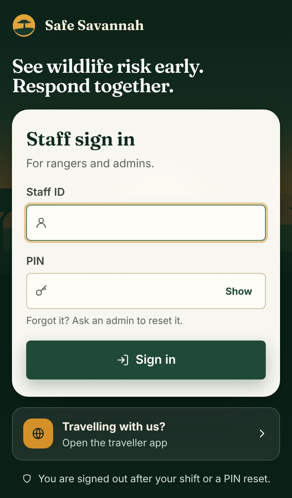 | 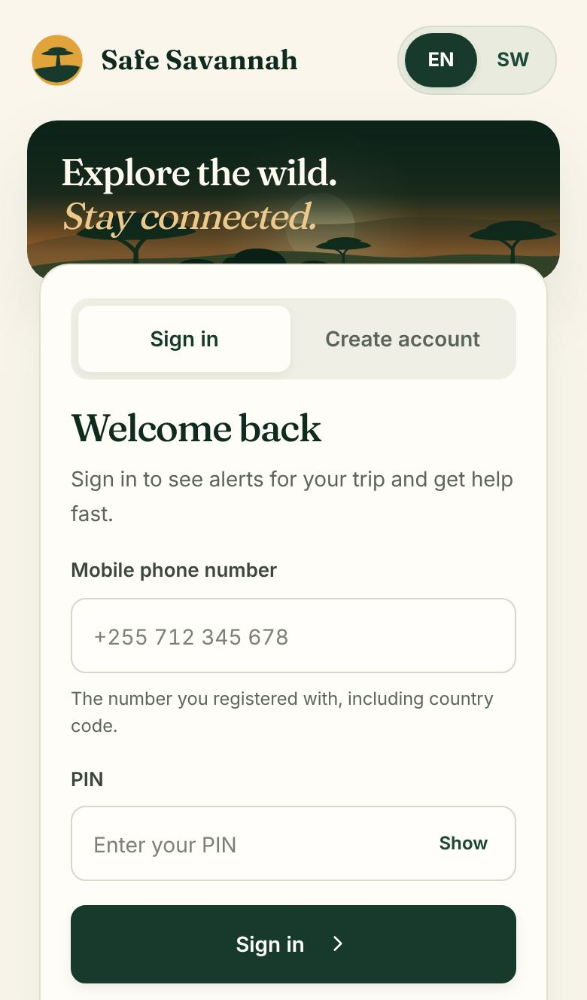 |

- **Staff sign in:** staff ID and PIN, with a Show/Hide PIN button. A wrong entry says "Staff ID or PIN is not
  right" and keeps the ID filled in. A link below the card opens the traveller app.
- **Traveller:** one card with **Sign in** and **Create account** tabs, the EN/SW switch in the header, and the
  emergency line under the card. Creating an account takes two steps: *Your account* (name, phone, PIN), then
  *Your trip* (destination, lodge, dates, group size).

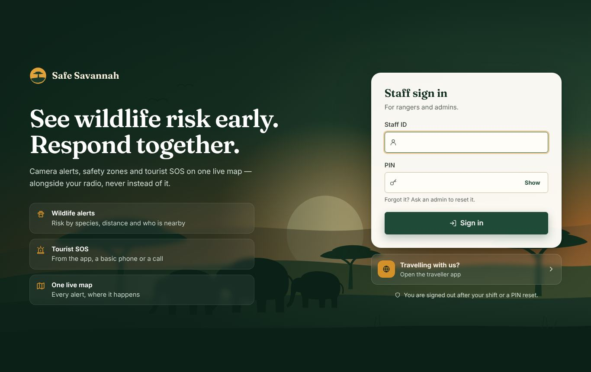

### Traveller app

| Home | Alerts | SOS | SOS tracker |
|---|---|---|---|
| 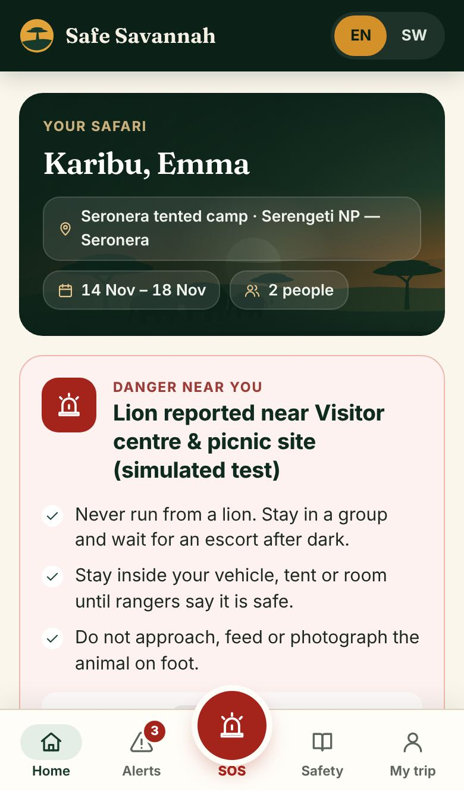 | 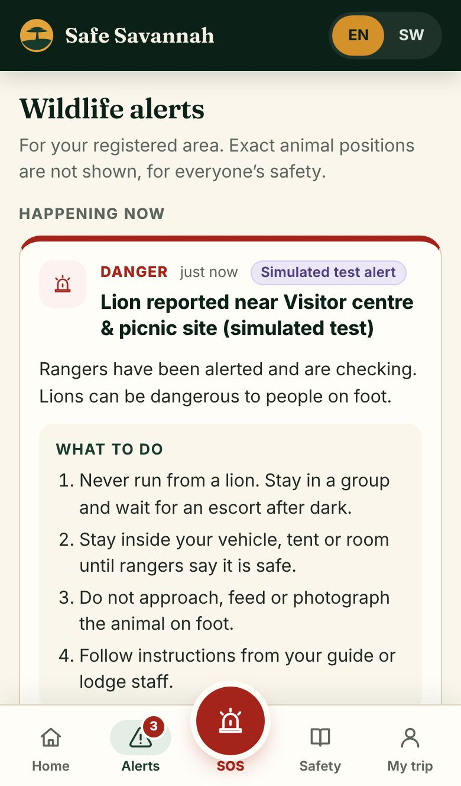 | 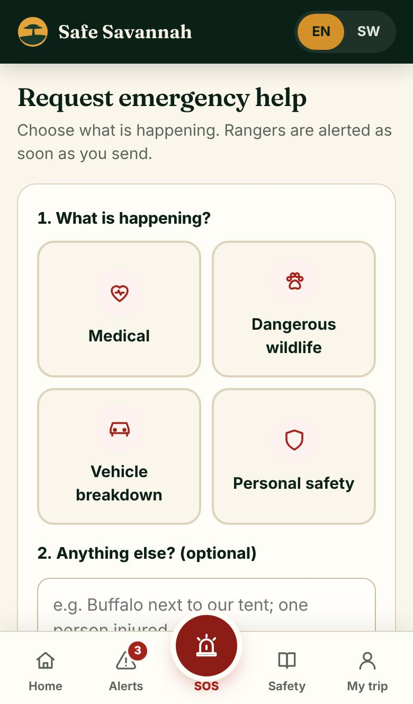 | 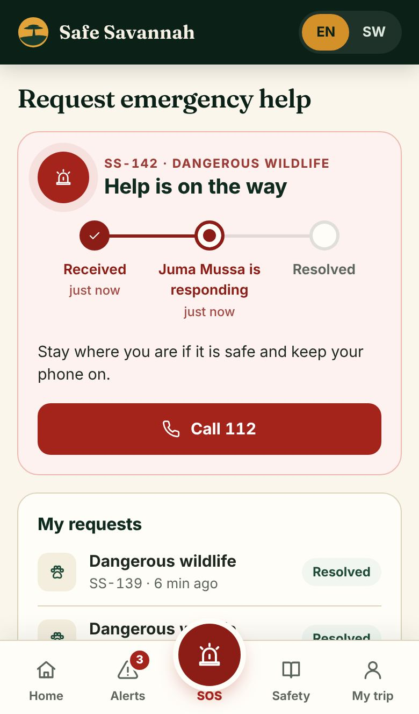 |

| Screen | What it shows |
|---|---|
| **Home** | A trip card (camp, dates, group), then **one reported status**: *No active alerts reported*, *Rangers are watching wildlife nearby*, or a *Warning* / *Danger* card with the top three things to do. The last update time and stale-data notice show whether the information is current. Below: a large **SOS** button and quick actions (share location, call the emergency line, safety tips). An open SOS shows its tracker at the top. |
| **Alerts** | *Happening now* first, each with a Danger / Warning / Advisory label and a "What to do" list; earlier alerts (last 48 h) fold up. Exact animal positions are never shown. |
| **SOS** | Three steps: pick the emergency type, add details if you want, then **Send SOS** (with a confirmation). After sending, a live tracker shows *Received → [ranger] is responding → Resolved* with times, and a Call button. |
| **Safety** | Guidance by topic (elephants, big cats, buffalo, hippos, camp at night, vehicle breakdown) and useful Kiswahili phrases, explained in the guest's language. |
| **My trip** | Edit destination, lodge, dates, group, emergency contact and SMS alerts; account panel with sign-out. |

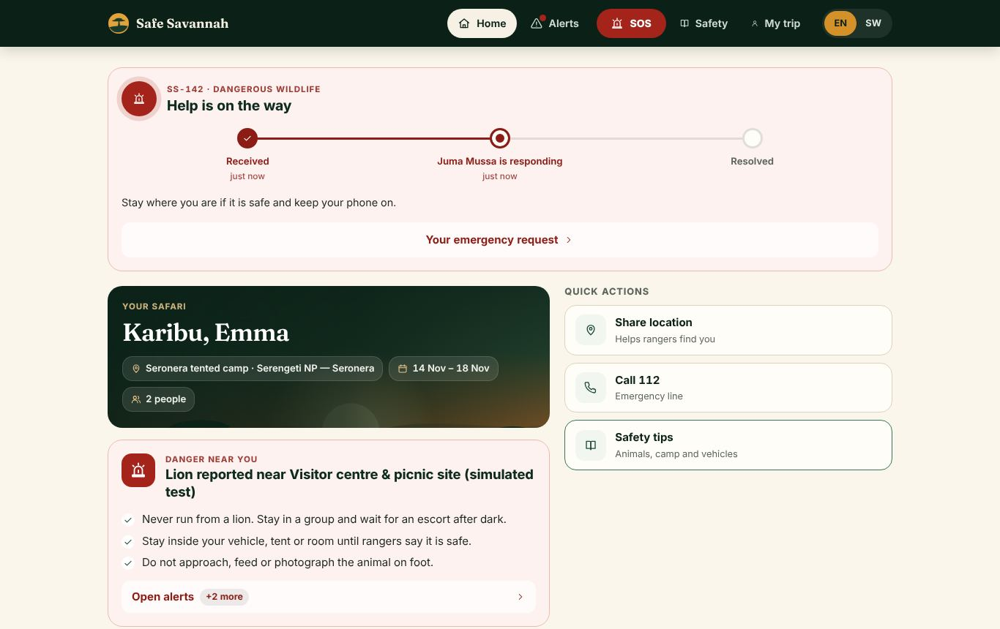

### Ranger console

| Live map (phone) | Incidents (phone) | Incident (phone) |
|---|---|---|
| 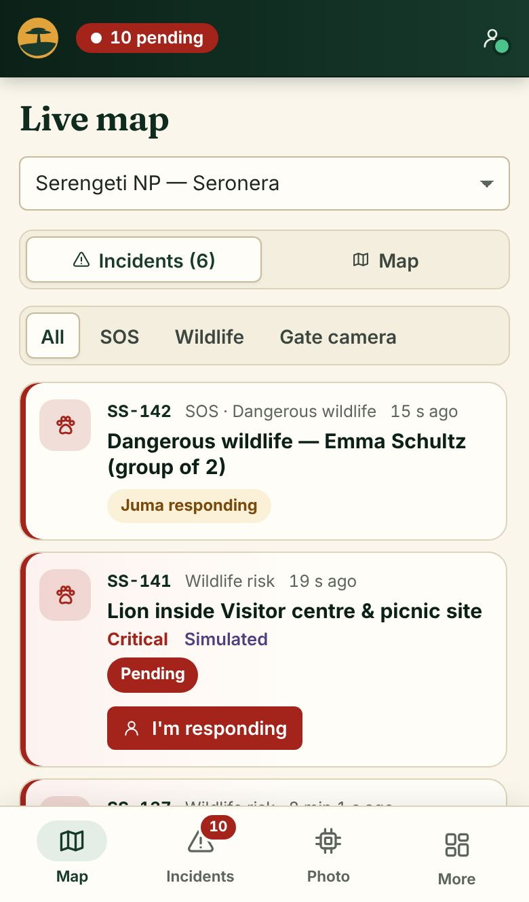 | 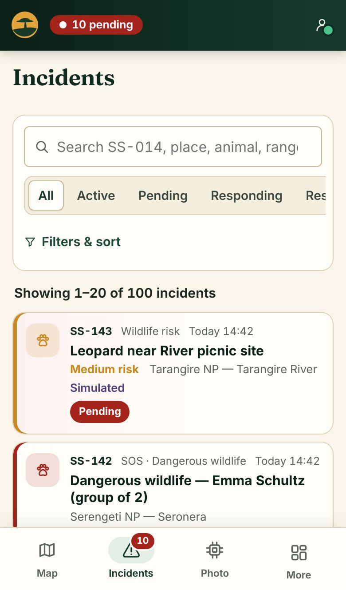 | 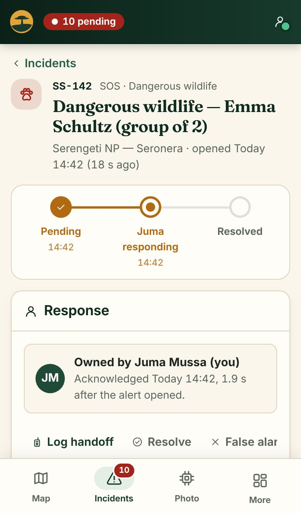 |

| Screen | What it is for |
|---|---|
| **Live map** | Open alerts and SOS, most urgent first. Each card shows the number, type, age, title, risk and status, with **I'm responding** on the card. On phones an **Incidents / Map** switch shows one at a time; computers show both. Admins can run demo scenarios here. |
| **Incidents** | Search plus status chips (All, Active, Pending, Responding, Resolved, False alarms). Type, sort, area, risk and dates are under **Filters & sort**. Phones show compact cards; computers show a table. Admins can export CSV. |
| **Incident detail** | A one-line summary, the title and a **Pending → Responding → Resolved** tracker with the responder's name and times. **I'm responding** comes first; once you own it, tabs for **Log handoff**, **Resolve**, **False alarm** and **Add note**. Details (photo, reporter with tap-to-call, why this risk level, map) and the activity log follow. |
| **Detections** | Every animal sighting with its risk and nearest zone. |
| **Check a photo** | Upload a wildlife photo; the AI model (or a labelled simulated detection) scores the risk. |
| **Gate camera** | The live camera feed with zone and detection overlays. |
| **Settings** / **Guide** | How the station is set up (read-only), and handling an alert in four steps. |

The header always shows how many incidents are **pending** (it links to them) and your duty state: a green dot
on your account icon, and an **On duty / Off duty** label on computers. Switch it from the account menu.

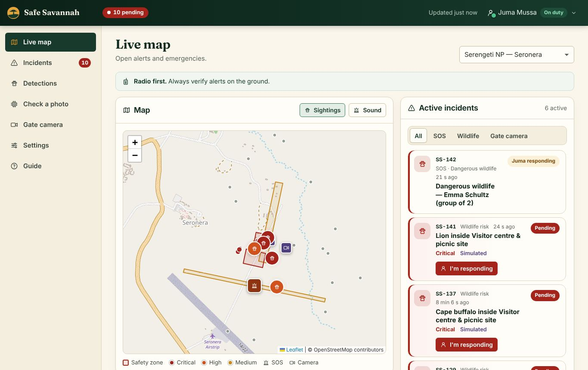

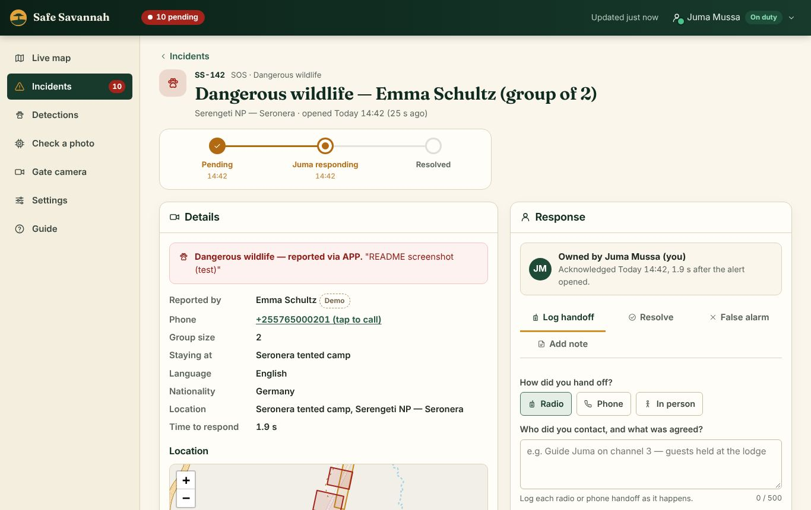

### Admin screens

| People (phone) | Reports (phone) |
|---|---|
| 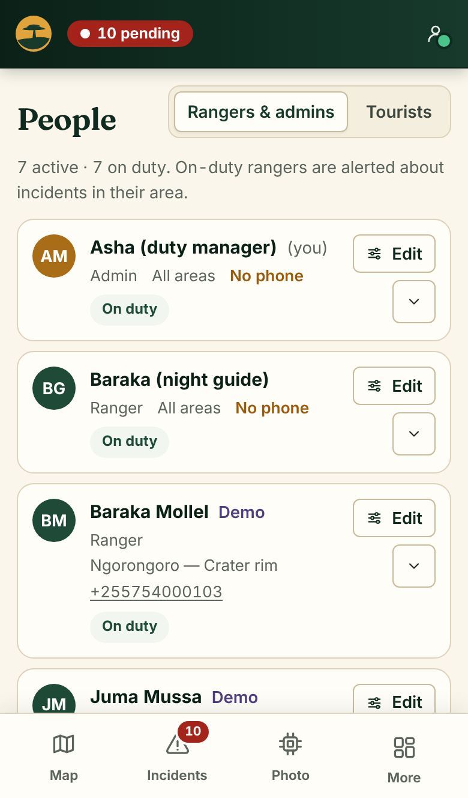 | 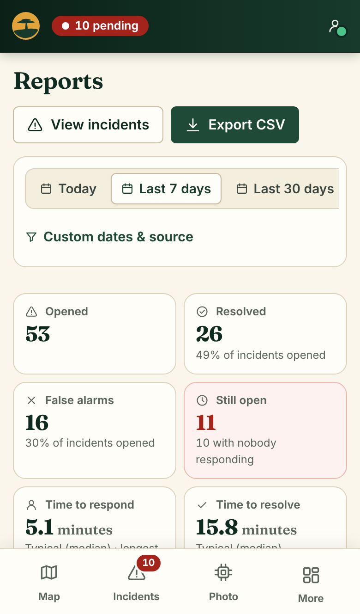 |

| Screen | What it is for |
|---|---|
| **Dashboard** | Five numbers (tourists today, rangers on duty, detections, SOS reports, still open), response times and detections by species, over 7–90 days. |
| **Safety zones** | Pick an area, click **New zone** and click the map to draw it. Zones are a compact list (coloured dot = sensitivity); click one to edit or deactivate it. |
| **People** | **Rangers & admins:** one row each with role, area, phone (flagged if missing) and duty state. **Edit** opens a short form (role, phone, area, on duty); **Reset PIN** and **Deactivate** are in the ⋯ menu; **Add a ranger or admin** folds away. **Tourists:** searchable, with *On trip / Upcoming / Trip ended* status, tap-to-call, their SOS history and deactivate/reactivate. |
| **Reports** | Pick Today or the last 7/30/90 days (custom dates and source under a fold). Shows opened, resolved, false alarms, still open, and typical time to respond and resolve, with a per-day chart and incidents by zone. **Export CSV**. |
| **Settings** | Camera, detection rule and station basics; timings and other details under **Technical details**. |

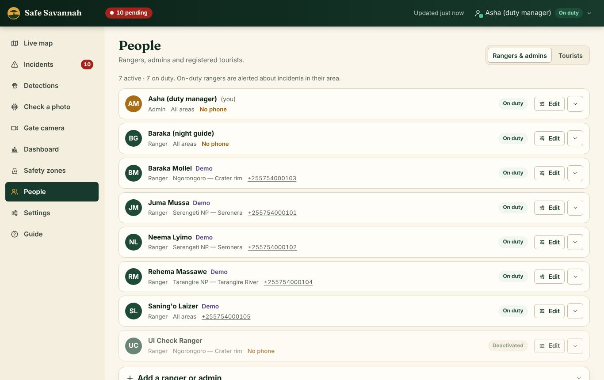

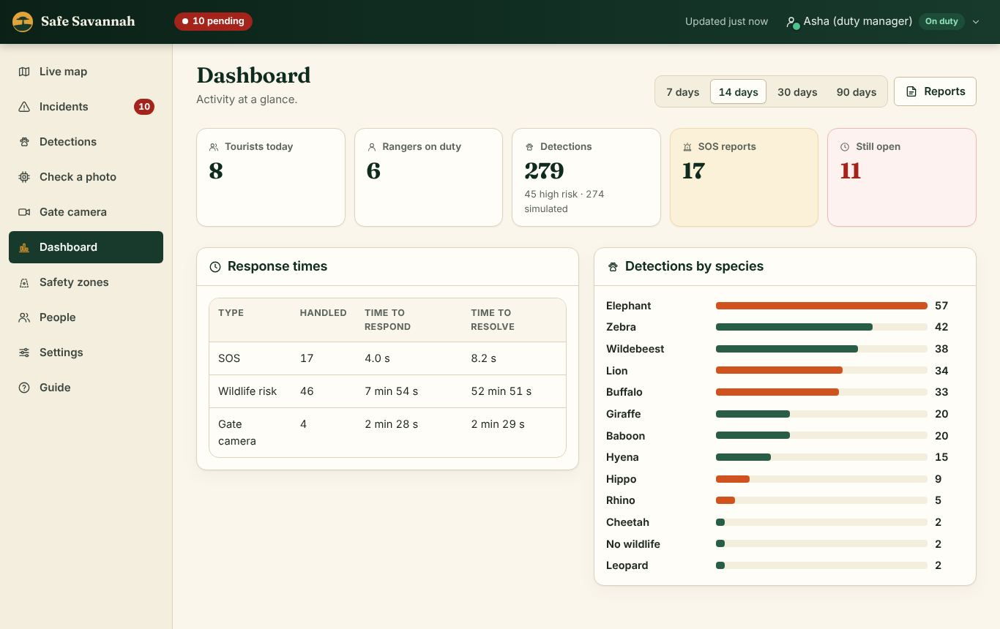

To refresh these images after a UI change, run the app with seeded data and capture new ones at the same sizes
(phone: iPhone 13 viewport; computer: 1366×860).

## Hospitality: lodges, check-in, roll call and all clear

Lodges and camps are partners in the system, not just places on the map. Each one sits on its own safety zone,
has a front-desk account and a check-in QR code. Four features build on that:

| Feature | What happens |
|---|---|
| **Lodges and the front desk** | Admins add a lodge under **Lodges & camps**: name, area, the safety zone it sits on and a front-desk phone. A **Front desk** account (Staff management, role *Front desk*) sees only that lodge: guests staying tonight with tap-to-call, wildlife alerts at the property and in the area, guest SOS, and the roll call. Front-desk accounts cannot open ranger screens or data; the server enforces this. |
| **Check-in by QR code** | The front desk prints the lodge's QR code. A guest scans it: new guests get the two-step sign-up with the lodge and area already filled in (only dates and group are left); registered guests sign in and confirm their leaving date. Either way they are linked to the lodge for their stay. Admins can replace the code if a printout goes missing. |
| **"Are you safe?" roll call** | A **high or critical** wildlife alert at a lodge's zone starts a roll call by itself (the front desk can also start one, for example as a drill). Every guest staying tonight gets one SMS, *"Are you safe? Reply SAFE or HELP"* (Kiswahili: *SALAMA* / *MSAADA*; other languages reply *1* / *2*) in their own language, instead of a second warning, and a big **I'm safe / I need help** card in the app. **I need help** opens an SOS for the rangers with the guest's location. The front desk watches answers arrive (safe, needs help, no reply), calls anyone silent and can mark them safe after seeing or speaking to them. The incident log records when the roll call started and when everyone answered. |
| **All clear** | When a ranger resolves the incident (handled or false alarm), every guest and lodge that was warned or asked gets an **all clear** in their language, by SMS and in the app, and the roll call ends. SOS incidents never send an all clear. |

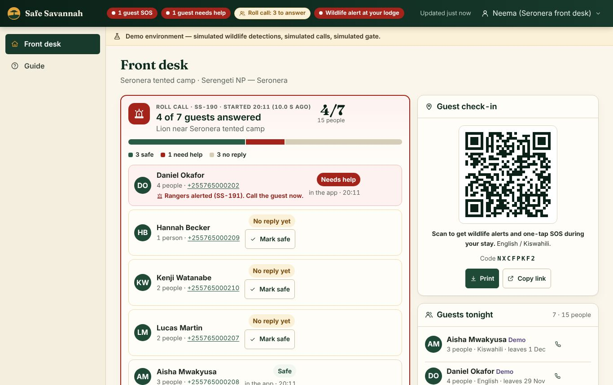

| Check in by QR (phone) | Are you safe? (phone) | All clear (phone) | Front desk (phone) |
|---|---|---|---|
| 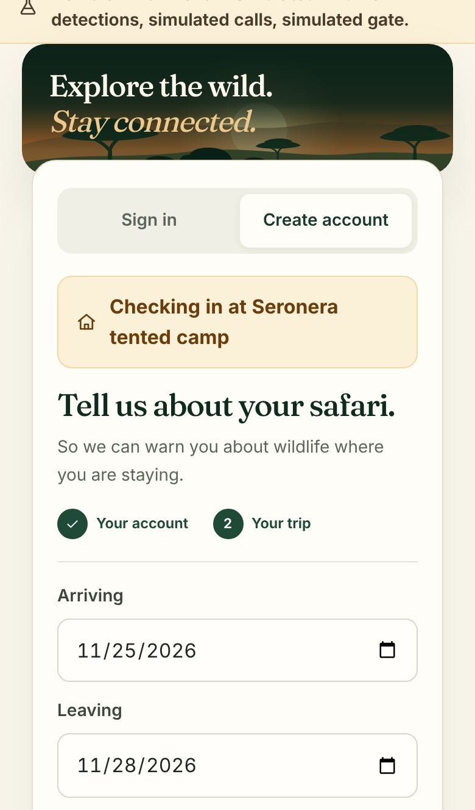 | 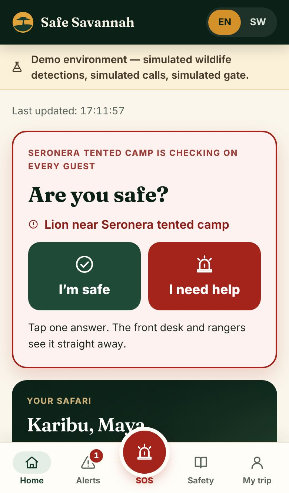 | 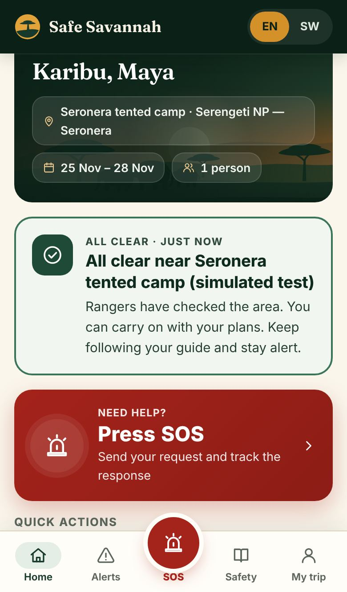 | 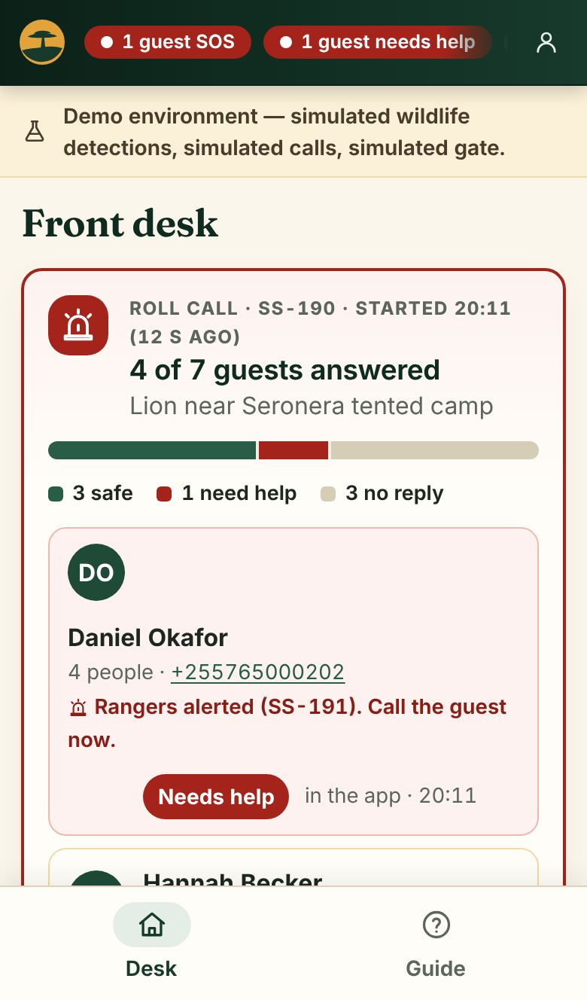 |

**Demo (about two minutes):**

1. Sign in as `desk1` / `3579` on a laptop: the Seronera tented camp front desk, with its QR code and six guests.
2. On a phone, scan the QR code (or open its **Copy link**) and register a new guest. They land on Home,
   checked in at the camp.
3. As an admin, open the **Live map**, expand **Demo scenarios** and run **Lion near tented camp**. Within
   seconds the phone shows **Are you safe?** and the front desk shows the roll call. The header shows
   *Wildlife alert at your lodge*.
4. Answer **I'm safe** on the phone; mark another guest safe from the front desk. Answer **I need help** as
   another guest (for example `+255765000202` / `1234`): the desk shows *Needs help* and rangers get an SOS.
5. As ranger `juma` / `2468`, open the lion incident and **Resolve** it. The phone shows **All clear** and
   the roll call ends with a summary.

SMS replies arrive through Africa's Talking's incoming-message callback (see below). Without a public tunnel
and `WEBHOOK_TOKEN`, guests answer in the app and the front desk confirms the rest.

## Guest requests: night escorts and going out

Two everyday requests that also make the safety picture more accurate.

| Feature | What happens |
|---|---|
| **Night escort** | After dark a guest taps **Night escort**, says where they are (e.g. *Tent 9*) and where they are going (restaurant, reception, bar, their room or somewhere else) and how many people. The front desk sees it at the top of the page with a *1 escort waiting* pill in the header, taps **Accept**, types who is going (*"Joseph is on the way"*) and **Done** when the guest has arrived. The guest's app follows each step: *Waiting → Joseph is on the way → Done*. One open request per guest. |
| **Going out (activity check-in)** | Before a game drive, walk, picnic or sundowner, the guest (or the front desk, with **Log an activity**) records where they are going, how many people and when they will be back. The front desk lists everyone out and marks them **Back**; a group 30 minutes past its return time shows as **overdue** in red and in the header. The rangers' live map shows a blue head-count marker on that zone (no names). If wildlife is detected there, the risk engine counts those people as present now, so a lion near a trail at a quiet hour still rises to high or critical, and the front desk's alert says *2 guests out here*. |

| Going out (phone) | Night escort (phone) | Home with both (phone) |
|---|---|---|
| 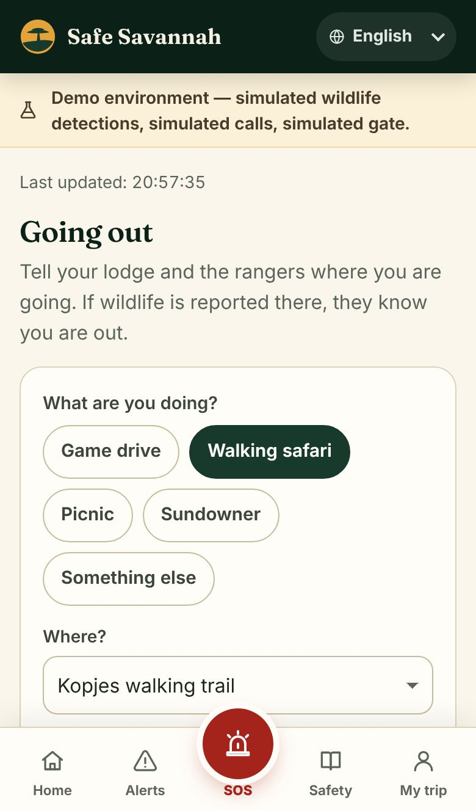 | 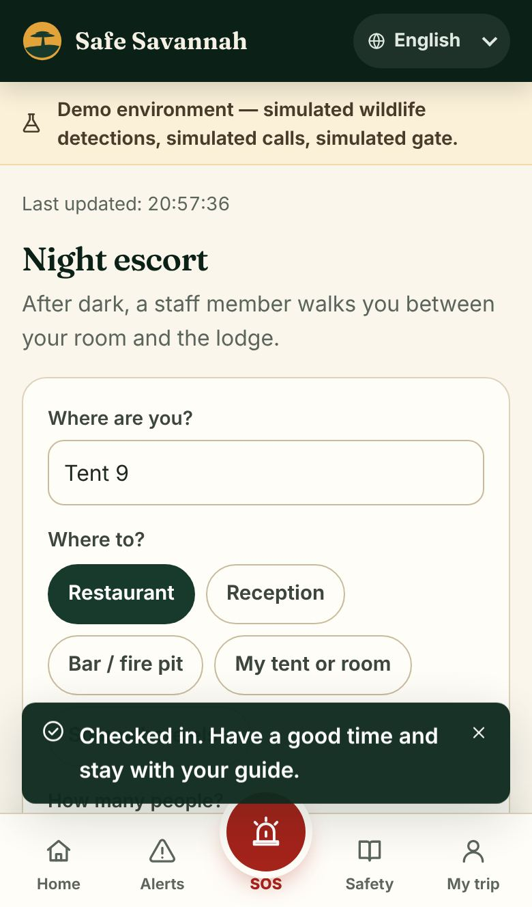 | 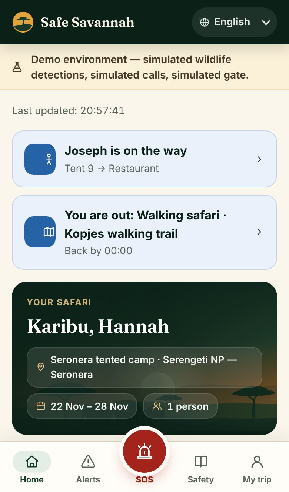 |

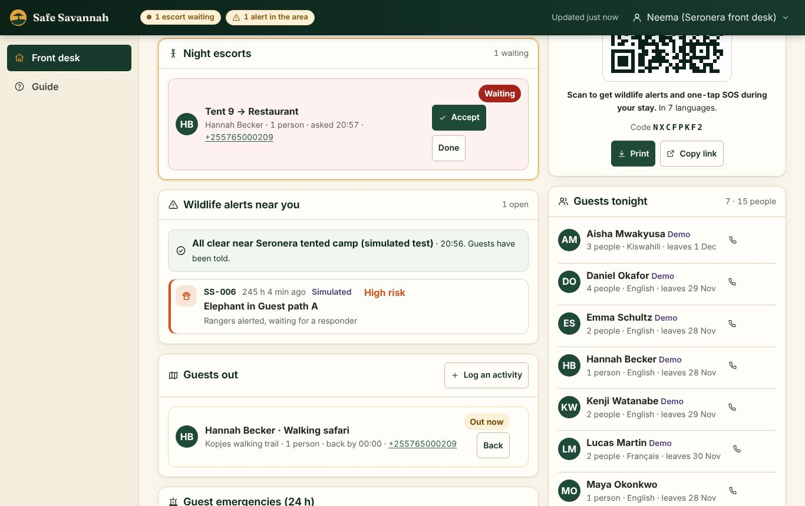

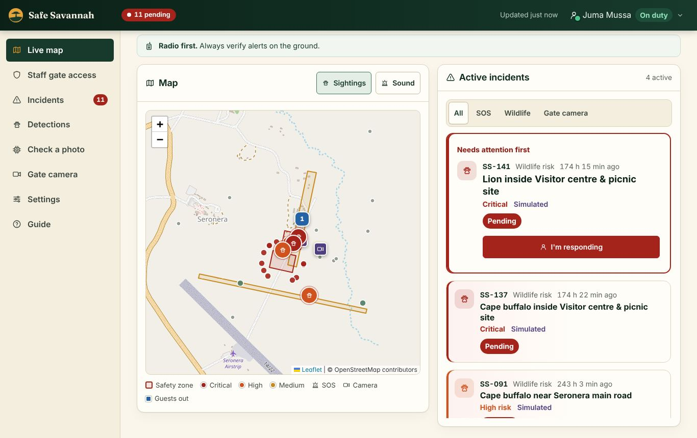

**Demo:** sign in as guest `+255765000209` / `1234` (Hannah, Seronera tented camp). Tap **Going out**, pick
*Walking safari* on *Kopjes walking trail*, then **Night escort** from *Tent 9* to the restaurant. As `desk1`
accept the escort; as ranger `juma` see the group on the map. Run **Lion near tented camp**: the alert at the
front desk notes the guests who are out.

## Guest languages

The traveller app, wildlife alerts, the roll call, the all clear and guest SMS come in **seven languages**:
English, Kiswahili, French, German, Italian, Spanish and Chinese (Simplified).

- **First visit** uses the phone's language when it is one of the seven, otherwise English. The globe menu in
  the header switches at any time; signed-in guests' choice is saved to their account, so their SMS switch too.
- **Alerts and all clears** are written in every language when they are created (`tourist_alerts.content`), so
  each guest reads the same alert in their own language, and staff see which language each guest uses.
- **SMS roll call:** English and Kiswahili guests reply *SAFE* / *HELP* (*SALAMA* / *MSAADA*); the other
  languages reply **1** (safe) or **2** (need help). The words *sûr*, *sicher*, *salvo*, *安全*, *救命* and so on are
  understood too.
- **USSD and voice calls** stay English and Kiswahili.
- Translations live in `public/js/tourist/locales/` (screens) and `src/domain/locales/` (alerts and SMS). They
  were machine-assisted; **have a native speaker review them before a real launch**. Accented and Chinese
  text is sent as Unicode SMS, which fits fewer characters per message, so some SMS go out in two parts.

| German sign-in (phone) | Roll call in French (phone) | Alerts in Chinese (phone) |
|---|---|---|
| 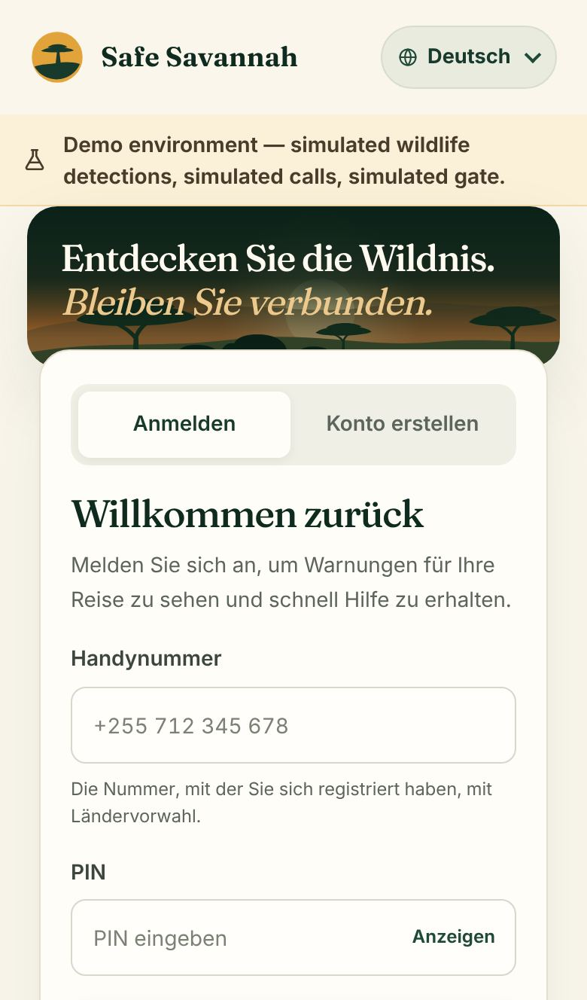 | 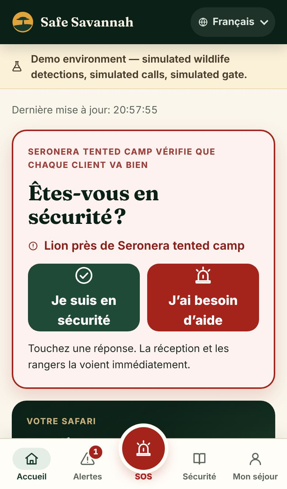 | 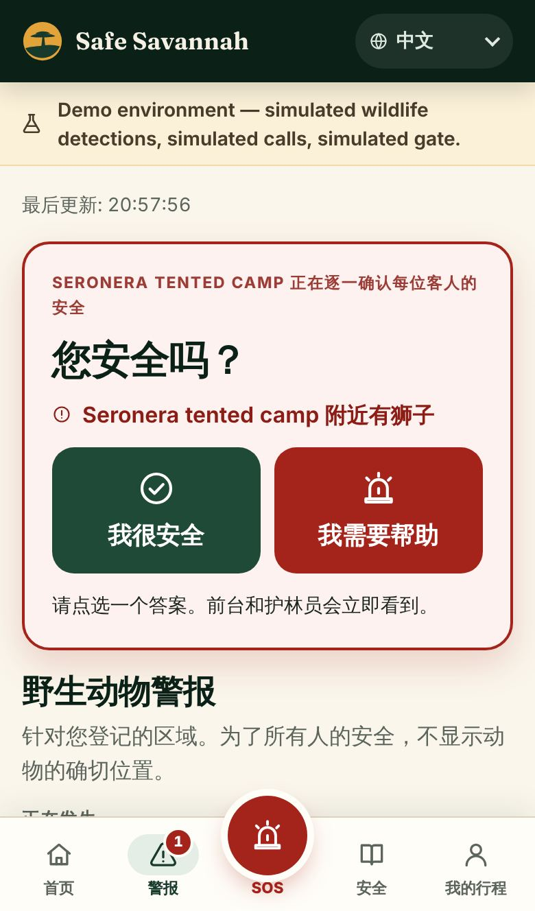 |

## Tour operators and guides

Tour operators (safari companies) and their guides get their own accounts, limited like front desks to their
own screen: **Tour operator** for the office, **Guide** for each guide. Admins add the company under
**Tour operators**, then the accounts in Staff management, and give each guide gate access to the attractions
they lead groups to.

1. **The office plans a group** for a day: name, guide, attraction, activity, time out of the park, and the
   travellers by the phone number they registered in the Safe Savannah app (numbers not registered yet are
   listed back).
2. **At the attraction gate the guide is verified** (face check, or badge and PIN), with the number of
   tourists declared. The guide's group for today is recorded as **in the park** there, with how it was
   verified and *3 declared, 2 registered*. A gate with no camera can record the entry by radio from the
   office screen instead. The group link never blocks or changes the gate decision.
3. **Its travellers are checked out on the activity** (see *Going out*): the risk engine counts them as
   people present, the rangers' map shows the head count, their lodges list them as out, and travellers see
   **My tour** in the app: the company, where the group is, the guide's name with a Call button.
4. **Rangers see tour groups on an incident** in that area, with the guide's phone. The office sees
   **Wildlife alerts near your groups** and each traveller's safety status (SOS, roll call), and marks the
   group **back**. A group 30 minutes late turns red.

Privacy: travellers see which company added them and what it can see, and can **leave the group** at any
time. Tour operator and guide accounts cannot open any ranger screen or data.

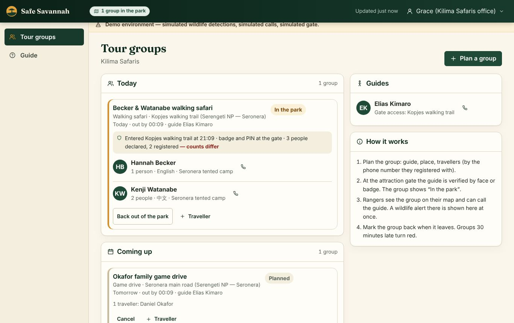

| Guide (phone) | My tour (traveller) | Ranger: groups on an incident |
|---|---|---|
| 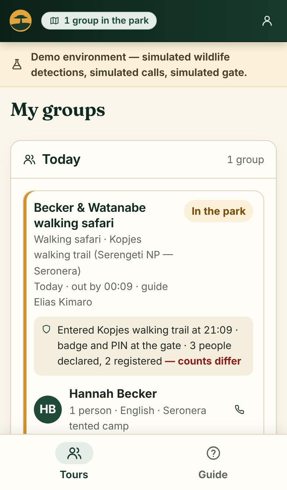 | 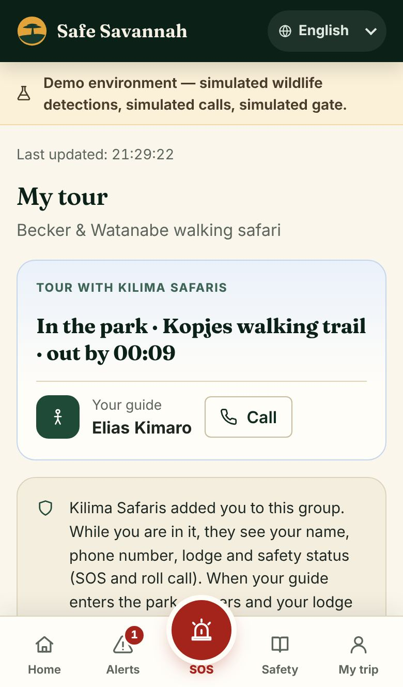 | 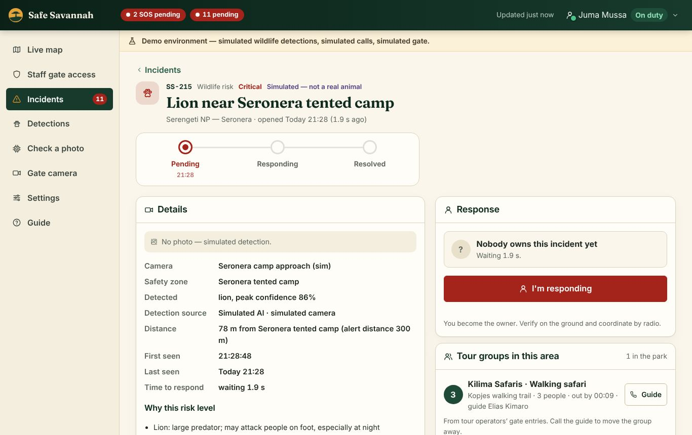 |

**Demo:** sign in as `tours1` / `4680`: *Becker & Watanabe walking safari* is planned for today with guide
Elias. As an admin, open `/#/access-manual` (**Gate permissions & manual review**), press **Start gate
camera**, then check *Kopjes walking trail*, staff ID `guide1`, PIN `4680`, **Tourists with this guide** `3`,
tick the badge check and **Verify staff access** (or use **In the park** on the office screen). The
office now shows the group in the park; Hannah (`+255765000209`) sees **My tour**. Run **Lion near tented
camp** and open the incident: the group and the guide's phone are listed.

## Today in the park

Travellers' Home shows **Today in the park**: the species seen today in their park area, how often, and
roughly when (this morning, this afternoon…), in their language.

- **Never live and never a place.** A sighting appears only a while after it happened (2 hours by default;
  20 minutes while the demo simulator runs; `SIGHTINGS_DELAY_MINUTES`), and only the park area is named,
  never a zone or a position.
- **Protected species are never listed**, whatever the source: rhino, pangolin, wild dog, chimpanzee, gorilla
  (`src/store/sightings.ts`). Low-confidence detections (under 50%) are left out.
- Simulated sightings are labelled.

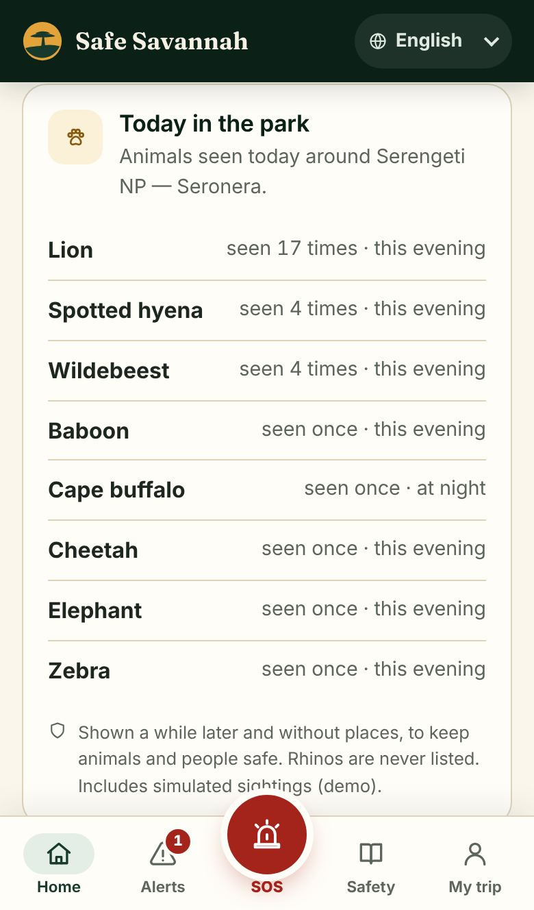

## Lodge and tourism report

**Tourism report** (admins: every partner lodge, or one; front desks: **Report**, their own lodge) for the
last 7, 30 or 90 days, with a **Spreadsheet** (CSV) download:

- **Guests:** people staying now, arrivals, guest-nights (people × nights), languages, countries, park areas
  and activities checked out.
- **Safety at each lodge:** wildlife alerts at the property and high or critical alerts in its area; roll
  calls with **the share of guests accounted for** (answered, or confirmed by the desk), how many needed
  help, and the median time until every guest had answered; guest SOS and the median ranger response time.
- **Guest requests:** night escorts and how fast they were accepted; activities and how many came back late.
- **Recent roll calls** one by one (answers in the app, by SMS or confirmed by the desk), and **tour
  operators**: groups, gate entries by face, badge or radio, people declared, groups back late.

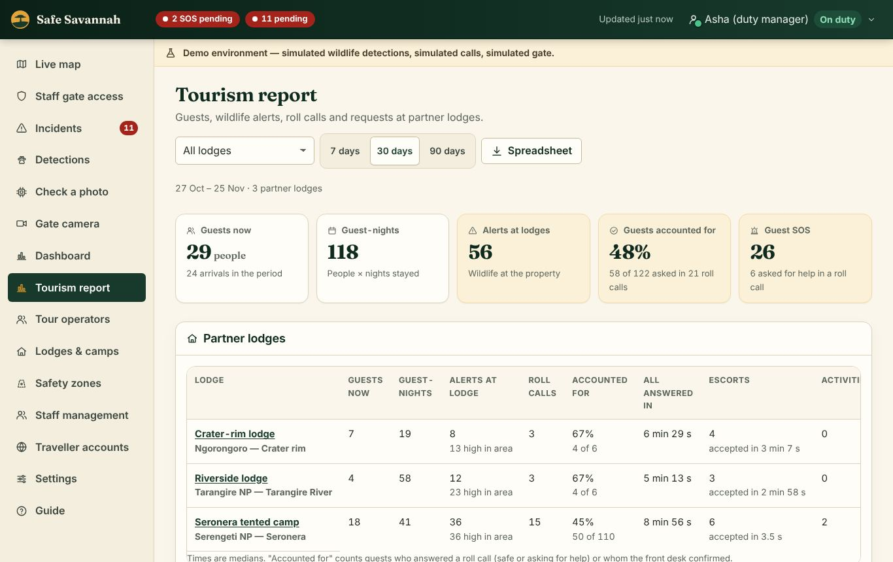

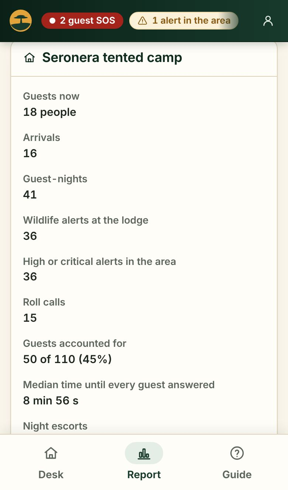

The demo seed adds a few past roll calls and night escorts at each lodge so the report is not empty.

## Africa's Talking

| Channel | What it does | How it runs here |
|---|---|---|
| **SMS** | Ranger alerts (risk ≥ medium), tourist warnings in their language (risk ≥ high), SOS confirmations and status updates | Sent through the **Africa's Talking API**. With `AT_ENVIRONMENT=sandbox`, `AT_USERNAME=sandbox` and your sandbox `AT_API_KEY`, messages appear in the [AT simulator](https://simulator.africastalking.com) for the recipient's number. **Without a key, nothing is sent**: the notifier logs a warning and records failed sends in the notification outbox. |
| **SMS replies** | Guests answer a lodge roll call by replying `SAFE` / `HELP` (or `SALAMA` / `MSAADA`, `1` / `2`) | Set the sandbox **incoming messages** callback to `https://<tunnel>/webhooks/sms-inbound?token=<WEBHOOK_TOKEN>`. Replies from numbers that are not in an open roll call are ignored. |
| **USSD** | Basic-phone menu: tourists request help (type → park if unregistered → confirm) or check status; ranger phones list alerts and mark "I am responding" | Callback `POST /webhooks/ussd?token=…` needs a public HTTPS tunnel and `USSD_ENABLED=true`. Dial your sandbox channel in the AT simulator. |
| **Voice** | Calls on-duty rangers for critical wildlife and every SOS; inbound emergency line with a keypad menu | Calls are **simulated and labelled** ("no phone rang") with `VOICE_PROVIDER=simulated`. Live calls require `VOICE_PROVIDER=africastalking` and a provisioned `AT_VOICE_NUMBER`. Callback: `POST /webhooks/voice?token=…`. |

Sandbox set-up:

1. Open the [Africa's Talking sandbox app](https://account.africastalking.com/apps/sandbox).
   Under **Settings → API Key**, generate a sandbox key and save it in the project's `.env`.
2. Use these settings (replace the two placeholders with your key and a random token):

   ```dotenv
   SMS_PROVIDER=africastalking
   AT_ENVIRONMENT=sandbox
   AT_USERNAME=sandbox
   AT_API_KEY=<your-sandbox-api-key>
   SMS_TEST_MODE=true
   USSD_ENABLED=true
   WEBHOOK_HOST=127.0.0.1
   WEBHOOK_PORT=8081
   WEBHOOK_TOKEN=<random-token-at-least-16-characters>
   ```

   Keep `.env` private; it is excluded from Git. Leave `AT_SENDER_ID` empty for the initial test.
3. Run `npm run dev`. On Windows PowerShell, use `npm.cmd run dev` if script execution policy blocks `npm`.
   Restart after editing `.env`. This starts both the API and the notifier that sends queued SMS.
   For testing communications without the camera worker, run `npm run api` and `npm run notifier`
   in separate terminals after migrations have been applied.
4. In another terminal run `ngrok http 8081`. Keep it running. Use the HTTPS forwarding address
   as `<tunnel>` below; expose the webhook listener on **8081**, not the dashboard on 8080.
5. In the sandbox's **USSD** section, create a channel and set its **Callback URL** to
   `https://<tunnel>/webhooks/ussd?token=<WEBHOOK_TOKEN>`, using the exact token from `.env`.
   Use the dial code assigned by the dashboard in the simulator.
6. In the sandbox's **SMS** delivery-report settings, set the callback to
   `https://<tunnel>/webhooks/sms-status?token=<WEBHOOK_TOKEN>`. For roll-call replies, set the
   **incoming messages** callback to `https://<tunnel>/webhooks/sms-inbound?token=<WEBHOOK_TOKEN>`.
   These URLs contain your private webhook token; share them only with the provider.
7. Open the [AT simulator](https://simulator.africastalking.com) with a seeded ranger's or tourist's
   number: `+255754000101` (Juma) or `+255765000201` (Emma). Sandbox interactions appear in the
   simulator, not on real handsets. See the [provider's sandbox guide](https://help.africastalking.com/en/articles/1170660-how-do-i-get-started-on-the-africa-s-talking-sandbox).
8. As Emma, dial your USSD channel. Check **My emergency status**, then **Request emergency help**
   → type → confirm. The SOS should appear in the ranger console and its confirmation SMS in
   Emma's simulated inbox. As Juma, dial the same code to list alerts and respond; Emma should
   receive the status update. These numbers must exist in your seeded database (`npm run seed`).

If the tunnel address changes, update both callbacks in Africa's Talking. A `403` response means
the callback token is missing or incorrect; `404` on the USSD callback means USSD is disabled
or the URL is wrong. For SMS authentication failures, check that the key came from the sandbox
app and that `AT_USERNAME=sandbox`. After adding a missing key, create a fresh test event:
previously rejected or expired jobs are not automatically sent again.

## How risk is decided (`src/domain/risk.ts`)

- **Species danger** (0–1) comes from a table: lion 0.95, buffalo/hippo 0.9, elephant/leopard/crocodile 0.85,
  rhino 0.8, hyena 0.55, cheetah 0.35, baboon 0.3, giraffe 0.15, zebra/wildebeest 0.1, antelope 0.05.
- **Proximity**: inside a zone counts 1.0. Within the zone's alert distance the factor scales from 1.0 down to
  0.45. Beyond it there is no risk.
- **Zone sensitivity**: high 1.0, medium 0.7, low 0.35.
- **People present now**: always, daytime (06–19 lodge time), night, or rarely. Registered tourists who shared a
  location within 300 m in the last 30 minutes add a further boost. **Guests checked out on an activity** (a game
  drive, walk or picnic) at that zone count as people there right now, whatever the zone's usual hours, and the
  reason says so: *"4 guests out here now on a walking safari, back by 17:30 (activity check-in)"*.
- **Detector confidence**: below 60% the score is down-weighted and the alert asks rangers to verify.
- The thresholds give the levels: low ≥ 0.10, medium ≥ 0.28, high ≥ 0.5, critical ≥ 0.75. **A harmless species
  never rises above low, even inside a lodge.**

Every detection is logged with its reasons. Medium and above opens (or refreshes) a wildlife incident. Each
camera + zone has at most one active incident; further sightings update it, and a rise in risk level re-alerts
once.

| Level | Rangers | Tourists in the area |
|---|---|---|
| medium | SMS | In-app advisory |
| high | SMS | In-app warning + SMS |
| critical | SMS + voice call | In-app danger + SMS |
| SOS (any type) | SMS + voice call | Reporter gets confirmation + status SMS |

Tourists are told the place name (e.g. "near Riverside lodge grounds"), never exact animal coordinates.

## AI wildlife monitoring

**Check a photo** accepts a camera image or wildlife photo (JPEG/PNG/WebP, ≤ 8 MB; phones open the camera). The
detection is placed at the chosen camera station's position and passed through the same risk engine.

- **Real model:** the pinned ONNX model (YOLO11n, see `scripts/export_model.py`) runs on the uploaded photo.
  The COCO model honestly recognises **elephant, zebra and giraffe** only. Other COCO animals (cow, horse,
  dog…) are shown but **not** mapped to wildlife: a "cow" is never reported as a buffalo. Lion, buffalo, hippo,
  rhino and leopard need a wildlife-specific model. Export one with the same script and labels such as `lion`
  or `buffalo` are picked up automatically by name.
- **Simulated:** when no model is installed, or for species it can't name, staff can record a *simulated
  detection* of a chosen species. It is stored as `analysis = simulated` and labelled **Simulated** everywhere.
- **Camera simulator:** a background worker feeds random **simulated** sightings from demo camera stations
  every `SIMULATOR_INTERVAL_SECONDS`. Admins can pause it or run named **demo scenarios** from the Live map:
  lion near camp, elephant in lodge, buffalo on trail, hippo near picnic site, giraffe through lodge (stays
  low), zebra on road, elephant far away (no risk).

Simulated detections, real model detections, uploads and demo history are each labelled differently on the
map, the incident pages, Detections, the Dashboard (which states the simulated/real split) and in every SMS
("TEST … (SIMULATED)").

## Security and roles

| | Tourist | Front desk | Tour operator / guide | Ranger | Admin |
|---|---|---|---|---|---|
| Own trip, alerts for own area, SOS, status, check in, answer roll calls, leave a tour group | ✓ | | | | |
| Own lodge: guests tonight, alerts, guest SOS, roll calls, check-in QR, lodge report | | ✓ | | | ✓ (any lodge) |
| Own company's tour groups (guides: their own groups; only the office plans) | | | ✓ | | ✓ (any) |
| Map, incidents, detections, photo check, set own on-duty | | | | ✓ | ✓ |
| Respond / resolve / log handoffs | | | | ✓ | ✓ |
| Lodges, tour operators, zones, people, tourist accounts, tourism report, CSV export, scenarios, settings | | | | | ✓ |

- Separate signed, httpOnly, SameSite=strict cookies for staff and tourists.
- PINs are hashed with scrypt.
- A PIN reset, role change or deactivation ends the person's sessions.
- Every permission is enforced on the server.
- Pages use a strict CSP (map tiles are the only external origin).
- Snapshots and uploaded photos are served only to signed-in staff.
- The settings page never shows credentials.

## Platform API (selected)

| Route | Who | Purpose |
|---|---|---|
| `POST /api/tourist/register` · `login` · `logout` | public | Traveller accounts (phone + PIN) |
| `GET/PATCH /api/tourist/me`, `POST /api/tourist/location`, `POST /api/tourist/sos` | tourist | Feed (alerts, own SOS with status), trip, location, SOS (a double press within 2 min returns the same SOS) |
| `GET /api/map?area=` | staff | Zones, cameras, active incidents, recent detections |
| `POST /api/incidents/:id/status` | staff | `responding` or `resolved` (`outcome: handled \| false_alarm`, note required); notifies the SOS reporter |
| `GET /api/detections`, `GET /api/detections/:id/image` | staff | Detection log and photos |
| `GET /api/ai/status`, `POST /api/ai/analyze` (multipart) | staff | Model capabilities; analyse a photo (`mode=model\|simulated`) |
| `GET/POST/PATCH /api/zones` | staff read, admin write | Geofences (polygon `[[lat,lng],…]`, kind, sensitivity, occupancy, alert distance) |
| `GET /api/tourists`, `PATCH /api/tourists/:id`, `POST /api/rangers`, `PATCH /api/rangers/:id/contact` | admin | People management |
| `GET /api/stats?days=`, `POST /api/sim/scenario`, `POST /api/sim/state` | staff / admin | Statistics, demo scenarios, pause simulator |
| `GET /api/public/lodges/:code`, `POST /api/tourist/checkin`, `POST /api/tourist/checks/:id` | public / tourist | Look up a check-in code, check in, answer a roll call (`safe` \| `help`; help opens an SOS) |
| `GET /api/lodge`, `/api/lodge/pulse`, `/api/lodge/qr.svg`, `POST /api/lodge/checks`, `…/checks/:id/responses/:touristId`, `…/checks/:id/close` | front desk, admin (`?lodge=`) | Front-desk view, header status, check-in QR, start / confirm safe / end a roll call |
| `GET /api/tourist/places`, `POST /api/tourist/escort`, `…/escort/:id/cancel`, `POST /api/tourist/activities`, `…/activities/:id/back\|cancel` | tourist | Places to go out to, ask for or cancel a night escort, check out on an activity and back in |
| `GET /api/lodge/report`, `/api/lodge/report.csv` (`?days=&lodge=`) | front desk (own lodge), admin | Lodge and tourism report |
| `GET /api/tours`, `/api/tours/pulse`, `POST /api/tours/groups`, `…/groups/:id/members`, `…/members/:touristId/remove`, `…/groups/:id/enter\|back\|cancel` | tour operator, guide (read), admin | Tour groups: plan, add travellers, record a radio entry, mark back |
| `GET/POST /api/tours/operators`, `POST /api/tourist/tour-groups/:id/leave` | admin / tourist | Tour operators; a traveller leaves a group |
| `POST /api/lodge/escorts/:id/accept` (`escort_name`), `…/escorts/:id/done`, `POST /api/lodge/activities`, `…/activities/:id/back\|cancel` | front desk | Handle escorts; log an activity for an in-house guest and mark the group back |
| `GET/POST/PATCH /api/lodges`, `POST /api/lodges/:id/code` | admin | Lodges and new check-in codes |
| `POST /webhooks/sms-status`, `/webhooks/sms-inbound`, `/webhooks/ussd`, `/webhooks/voice` | provider (token) | Africa's Talking callbacks (delivery reports, roll-call replies, USSD, voice) |

## Tests

```bash
npm test
```

152 tests. `test/platform.test.ts` covers:

- geofencing and the risk engine (species, distance, occupancy, confidence, harmless species);
- detection → incident → ranger/tourist SMS and voice (atomic, deduplicated, escalation);
- that demo people are never messaged through a live account;
- SOS de-duplication, plus the USSD and voice menus;
- the tourist API end to end, including ranger status updates reaching the tourist;
- admin-only permissions, geofence validation and AI upload modes;
- that scenarios are labelled simulated;
- that the Africa's Talking adapter sends nothing without a key.

`test/hospitality.test.ts` covers lodges, QR check-in, the roll call (including SMS replies in every language)
and the all clear; `test/guestPlans.test.ts` covers night escorts, activity check-ins and their effect on risk;
`test/i18n.test.ts` checks that every language has every species, safety step, alert and SMS text;
`test/tours.test.ts` covers tour groups and the gate link, partner access limits, Today in the park
(delay, area, protected species) and the tourism report.

The earlier suites still cover the gate camera, the outbox and the dashboard API.

---

# Gate camera module (original MVP)

The first module is still part of the platform. One fixed camera watches a marked image-space zone. Its alerts
appear as **Gate camera** incidents on the map (placed at the camera station's position) and in the incident
list, and they use the same outbox. The details below describe that module.

## How it works

```
camera / replay ──ffmpeg──▶ vision worker ──▶ zone rule ──▶ PostgreSQL ──▶ dashboard (polls every 2.5 s)
  (5 fps, 640² letterbox)   YOLO11n ONNX     (feet in       events          acknowledge, handoff,
                            "elephant"        polygon ×3)   + SMS outbox     close / false alert
                                                              │ LISTEN/NOTIFY
                                                              ▼
                                                        notifier ──▶ Africa's Talking SMS (or mock)
```

Three processes share one PostgreSQL database. `npm run dev` / `npm start` runs all three under a small
admin, so model inference never blocks the dashboard.

| Process | What it does |
|---|---|
| `vision` | ffmpeg decodes the source at `SAMPLE_FPS` into a letterboxed 640×640 frame. Only the newest frame is kept: if inference falls behind, old frames are dropped and counted, so lag does not build up. Runs the detector, applies the zone rule, writes the alert and SMS job **in one transaction**, refreshes `last_seen_at`, and writes a camera heartbeat and an annotated live frame. |
| `notifier` | Transactional-outbox worker. It wakes on `NOTIFY` from new alerts and polls for retries. It uses `FOR UPDATE SKIP LOCKED`, retries known transient failures with capped backoff, marks ambiguous outcomes as `unknown`, and expires stale jobs. |
| `api` | Fastify server. It serves the login, the dashboard, the JSON API, authenticated snapshots and the live frame, plus the provider webhooks (optionally on a separate webhook-only port). Pages are sent with a strict Content-Security-Policy (no inline scripts, same-origin only), and nothing is loaded from a CDN, so the dashboard works on an offline lodge network. |

### Zone rule (`src/domain/zoneMonitor.ts`)

- A detection counts only when its label is `elephant` (resolved **by label** from the model manifest), its
  confidence is ≥ `CONFIDENCE_THRESHOLD` (0.45), and the **bottom-centre** of its box falls inside the zone
  polygon. The bottom-centre is a rough proxy for where the feet touch the ground. It is not a distance, GPS
  fix or track.
- `CONSECUTIVE_FRAMES` (3) in-zone frames in a row open an alert. The `first_seen_at` is the first frame of
  that streak.
- Each camera + zone has at most one active alert. A partial unique index in PostgreSQL enforces this.
  Further detections refresh `last_seen_at` but send no further SMS.
- **Rearming needs both** `CLEAR_SECONDS` (10) of valid frames with no in-zone detection **and** an operator
  closing the alert. A gap longer than `MAX_FRAME_GAP_MS` between frames is an outage. An outage resets the
  streak and the clear timer: an outage is *unknown*, never *clear*.
- The dashboard shows a zone as **UNKNOWN** whenever its camera has not delivered a frame within
  `STALE_FEED_SECONDS`.

These numbers are tuning defaults, not validated safety limits.

### Distinctions the UI keeps separate

| What the screen says | What it does **not** mean |
|---|---|
| SMS *accepted by provider* | that it was delivered |
| SMS *delivered* (delivery report) | that anyone read it |
| *Acknowledged by X* | that anyone has responded; log handoffs for that |
| Zone *armed — watching* | that the zone is clear or safe |
| SMS *unknown* (timeout / crash mid-send) | that it failed; check the handset before you press Resend |

## Gate camera set-up

Requirements: Node ≥ 22, PostgreSQL ≥ 14 (or Docker), `ffmpeg`/`ffprobe` on `PATH`.

```bash
npm install
```

```bash
docker compose up -d postgres     # or point DATABASE_URL at your own PostgreSQL
```

```bash
cp .env.example .env
```

```bash
npm run migrate
```

```bash
npm run operator:add -- --id duty1 --name "Asha (duty manager)" --pin 4821
```

The first operator you create is a **admin**. Admins add further operators from **Settings**, or
with `--role ranger|admin` on the same command.

### A. Simulated crossing (no model needed)

```bash
npm run fixtures:synthetic        # renders fixtures/synthetic-crossing.mp4 from the timeline
```

```bash
DETECTOR=scripted npm run dev
```

Open http://127.0.0.1:8080 and sign in. A grey block grazes outside the zone, walks onto *Guest path A* about
11 s into the clip, and leaves. The clip loops every 40 s. Events from this mode are labelled **SIMULATED** on
the dashboard and in the SMS text.

### B. Real inference (the judged demo)

1. Export and pin the model (Python venv, one time):

   ```bash
   pip install ultralytics onnx onnxslim
   ```

   ```bash
   python scripts/export_model.py --weights yolo11n.pt --out models
   ```

   ```bash
   npm run model:check               # verifies the SHA-256 pin and that "elephant" exists by label
   ```

   Ultralytics YOLO weights are **AGPL-3.0**. Review that before sharing or deploying the model or a service
   built on it. Cache the weights before demo day.

2. Get a legally reusable clip from a **fixed** viewpoint. For a quick check, the helper downloads a
   CC-licensed Commons video and saves its attribution next to it in `fixtures/local/` (git-ignored):

   ```bash
   scripts/fetch-commons-clip.sh "Mum_and_baby_Elephant_walking_toward_us..webm" 96 40 elephants-near
   ```

   That example clip (CC BY 3.0) is filmed from a vehicle, not a fixed camera. It checks that real inference
   works, but because the frame moves it is **not** a valid boundary-crossing test. For the crossing test,
   use footage from a fixed camera. Use Snapshot Serengeti stills for classification checks only.

3. Draw the zone for that view in `config/zones.json` (normalized `[x, y]` vertices, origin top-left).

4. Run:

   ```bash
   DETECTOR=onnx CAMERA_SOURCE=fixtures/local/elephants-near.mp4 npm run dev
   ```

   For a USB camera, set `CAMERA_SOURCE=/dev/video0`. Measured on the development container (CPU only):
   YOLO11n at 640² ran at about 50–67 ms per frame, which sustained 5 fps with no dropped frames. Measure
   again on your own laptop.

### C. Africa's Talking SMS

Start in the sandbox and use its simulator:

```bash
SMS_PROVIDER=africastalking AT_ENVIRONMENT=sandbox AT_USERNAME=sandbox AT_API_KEY=... \
SMS_RECIPIENTS=duty:+2557XXXXXXXX npm run dev
```

The message reads: `Safe Savannah TEST SS-014. Possible elephant at Guest path A. Check the duty dashboard and
follow your radio procedure.` It contains no coordinates. Send only to approved duty/test numbers, and never
contact real emergency services from a demo.

**Delivery reports (optional):** set `WEBHOOK_TOKEN` and `WEBHOOK_PORT`. Expose **only** that port over an
HTTPS tunnel, and register `https://<tunnel>/webhooks/sms-status?token=<WEBHOOK_TOKEN>` with Africa's Talking.
Delivery reports update notification state only. They never change who owns the incident.

**USSD:** follow the sandbox setup above. Ranger phone numbers are recognised from their active accounts;
`USSD_ALLOWLIST=+2557XXXXXXXX:duty1` can map an additional phone to an existing ranger. Their menu is:
`1` lists active alerts; `2` → alert number → review → `1` confirms the response. Other phones receive
the tourist help/status menu. Nothing is written before confirmation. USSD cannot push alerts.

## Using the dashboard

Open http://127.0.0.1:8080 and sign in. The console is deliberately small: each screen shows only what a
ranger needs to act. Messages (SMS, USSD, voice) are **not shown in the web app** — they go through Africa's
Talking and appear on the phone or in the AT sandbox simulator. If `AT_API_KEY` is missing, the server log
says so at start-up.

Every screen is described in [Screens](#screens). This section covers the gate camera.

The camera panel shows one of four states: **Live**, **Reconnecting** (the worker is retrying a failed
source), **Stale** (connected but no new frames) or **Offline** (the worker is not reporting). Anything other
than Live shows the zone as **UNKNOWN**. Feed controls work as follows:

- **Pause view** freezes the picture while detection carries on.
- **Zone** and **Detections** toggle the overlays.
- **Refresh** loads the newest frame.
- **Full screen** shows the feed full screen.

Keyboard users get a skip link, visible amber focus rings, and arrow-key tabs on incidents. Moving to a new
screen puts focus on its heading. The layout adapts to phones (bottom tab bar), tablets (icon rail) and
computers (side menu), and it respects reduced-motion settings.

### Roles

| | Ranger | Admin |
|---|---|---|
| View everything, acknowledge, log handoffs and notes, close, mark false alerts | ✓ | ✓ |
| Export incidents to CSV | | ✓ |
| Manage operators (add, change role, deactivate, reset PIN) | | ✓ |
| See technical settings and raw camera errors; run demo scenarios | | ✓ |

The server enforces every one of these permissions. Changing someone's role, deactivating them or resetting
their PIN ends their existing sessions. You cannot deactivate or demote yourself, and the last active
admin cannot be removed.

### HTTP API (signed-in session required)

| Route | Purpose |
|---|---|
| `GET /api/overview` | Counts, camera state (live/reconnecting/stale/offline), zones with outlines and active incidents |
| `GET /api/incidents` | Search, filter, sort and page (`q, status, source, zone, sms, owner, from, to, sort, order, page, pageSize`) |
| `GET /api/incidents/:id` | Detail with actions and a merged timeline |
| `GET /api/incidents/export.csv` | CSV of the same filters (admins). Times are UTC; cells that could run as spreadsheet formulas are neutralised |
| `GET /api/reports/summary?from&to&source` | Summary figures computed from stored records, by day in lodge time |
| `GET /api/settings` | Configuration view with no secrets; technical section for admins |
| `GET/POST/PATCH /api/operators…` | Operator management (admins) |
| `GET /api/cameras/:id/live.jpg`, `live.json` | Latest clean frame plus detection metadata for client-drawn overlays |
| `POST /api/events/:id/acknowledge`, `/actions` | Incident workflow (unchanged) |

## Judge demo script

1. Show the camera view: the elephant is **outside** the dashed polygon, so no alert.
2. The elephant crosses. After about 3 frames, the **SS-0xx** card opens and the SMS arrives in the Africa's
   Talking sandbox simulator (not in the web app). The snapshot shows the triggering box.
3. On the Live map, press **I'm responding** on the card, open the incident, and use **Log handoff** (Radio,
   "Guide Juma ch.3, guests held at lodge").
4. Messages keep working through outages: if the network drops, SMS wait in the outbox and are retried; ones
   older than `SMS_FRESHNESS_SECONDS` are marked **expired**, not sent late.
5. **Resolve** the incident with what was verified. The zone stays *awaiting clear* until it has been empty for 10 s.

## Acceptance tests

```bash
npm test
```

The integration tests need PostgreSQL at `TEST_DATABASE_URL` (default
`postgres://postgres@127.0.0.1:5432/safe_savannah_test`). The URL must contain "test", because the schema is
dropped. Tests that need a database or ffmpeg are skipped when either is unavailable.

| Plan requirement | Covered by |
|---|---|
| Outside-zone detections open nothing; 3 consecutive in-zone frames open exactly one alert | `test/zoneMonitor.test.ts`, `test/pipeline.test.ts` |
| Rearming needs a 10 s clear **and** operator close; an outage is not clear time; restart doesn't duplicate | `test/zoneMonitor.test.ts` |
| One event + one initial SMS job, written atomically; DB enforces one active alert per zone | `test/store.test.ts` |
| Acknowledgement attributed, timestamped and idempotent (also under concurrency) | `test/store.test.ts`, `test/api.test.ts` |
| Transient retry with backoff, ambiguous → `unknown`, crash mid-send → `unknown`, stale → `expired`, closed → `cancelled`, jobs survive restart | `test/outbox.test.ts` |
| Delivery reports never change incident ownership; out-of-order reports can't regress state | `test/outbox.test.ts`, `test/api.test.ts` |
| Camera not live → zone shown UNKNOWN | `test/api.test.ts` |
| Africa's Talking request/response semantics | `test/notify.test.ts` |
| USSD allowlist and confirm-before-write | `test/api.test.ts` |
| Incident search, filters, sort and pagination; detail timeline order; CSV export (admin-only, formula-safe) | `test/operations.test.ts` |
| Reports come only from stored records; empty ranges return no averages | `test/operations.test.ts` |
| Live / reconnecting / stale / offline camera states; settings never expose secrets | `test/operations.test.ts` |
| Roles enforced on the server; lock-out guards; PIN reset and role change end sessions; strict CSP | `test/operations.test.ts` |

### Per-clip evaluation and timing

```bash
npm run eval -- --annotations fixtures/local/inside.json --annotations fixtures/local/outside.json
```

Each annotation file names a clip, a zone and the crossing times you annotated by hand. Use `[]` for a clip
that should raise no alert. The command runs the real detector and zone rule over every sampled frame and
reports alerts, misses and false alerts **per clip**. That is not a claim about field accuracy. Include
outside-zone clips, empty clips, lookalikes (vehicles, cattle, rocks), and at least one clip with difficult
lighting or occlusion.

```bash
npm run report:timings
```

This prints, for each alert: first in-zone frame → stored event, event → provider acceptance / delivery, and
event → acknowledgement. Subtract your annotated crossing time from `first_seen` to get crossing → event.
Report the hardware and network along with the numbers. Do not turn demo numbers into claims about injuries
avoided or response-time percentages.

### Outage drills

Test each of these on its own:

- **Uplink:** unplug the network, or use the demo toggle. Detection, storage and the dashboard keep working,
  and SMS jobs queue. A remote ranger cannot get an SMS while the laptop can't reach the provider, and the
  recipient also needs mobile coverage.
- **Camera:** unplug it or point to a bad source. The feed shows **STALE/OFFLINE**, the zone shows
  **UNKNOWN**, the ffmpeg error is shown, and the worker keeps trying to reconnect.
- **Laptop:** the radio procedure must keep working without it.

## Project layout

```
src/domain      zone rule, geometry, zone config, SS-### refs  (pure, unit-tested)
src/vision      ffmpeg frame source, YOLO decode + ONNX detector, scripted detector, annotation, worker
src/store       PostgreSQL access: events/actions, incident search/reports, operators, camera + zone status
src/notify      outbox worker, Africa's Talking adapter, mock adapter, message text
src/api         Fastify server, pages (login + app shell), camera state, CSV, USSD menu
src/cli         operator:add, sim:events, fixtures:synthetic, eval, report:timings, model:check
migrations      SQL schema (applied by `npm run migrate` / on `npm run dev`)
public          dashboard: css/app.css, js/ (ES modules, one per screen), icons.svg (no build step)
```

`npm run sim:events` injects a **SYNTHETIC TEST** alert, so you can work on the dashboard and SMS path without
the vision worker.

## Before a field pilot

Go ahead only with a site partner, a named duty owner, a verified camera blind spot and the right operating
permissions. Run in shadow mode alongside the normal procedures first. Agree in advance how many false alerts
and missed detections are acceptable. Before you choose battery, solar or camera hardware, measure power draw
and night visibility. Restrict access to camera views and snapshots (they are served only to signed-in
operators and stored under `DATA_DIR`), and agree retention and maintenance with the lodge.

## References

- Africa's Talking: [country/product matrix](https://help.africastalking.com/en/articles/2727792-which-countries-are-africa-s-talking-products-in), [sandbox setup](https://help.africastalking.com/en/articles/1170660-how-do-i-get-started-on-the-africa-s-talking-sandbox)
- [Snapshot Serengeti](https://lila.science/datasets/snapshot-serengeti) (sequence labels are not reliable frame by frame: verify demo frames by hand)
- [MegaDetector scope](https://github.com/microsoft/MegaDetector/blob/main/docs/faq.md) (it detects animals, people and vehicles; it does not classify species)
- [Ultralytics COCO](https://docs.ultralytics.com/datasets/detect/coco/), [ONNX export](https://docs.ultralytics.com/integrations/onnx/)
